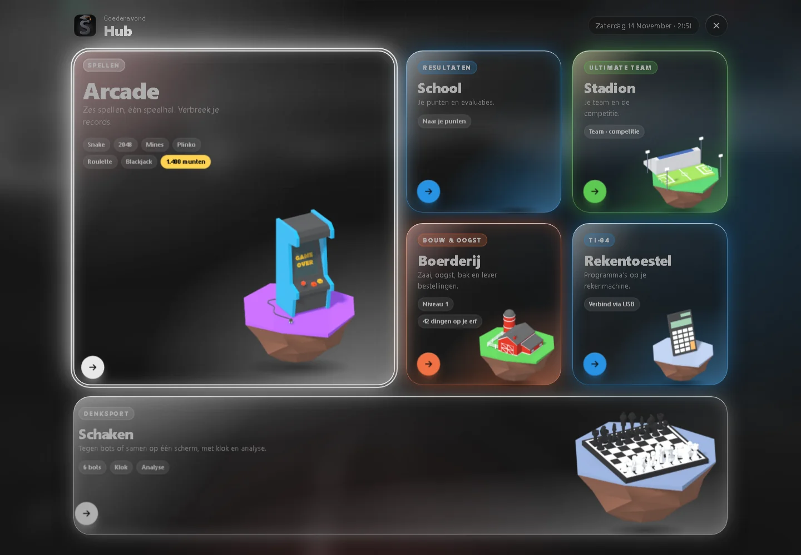
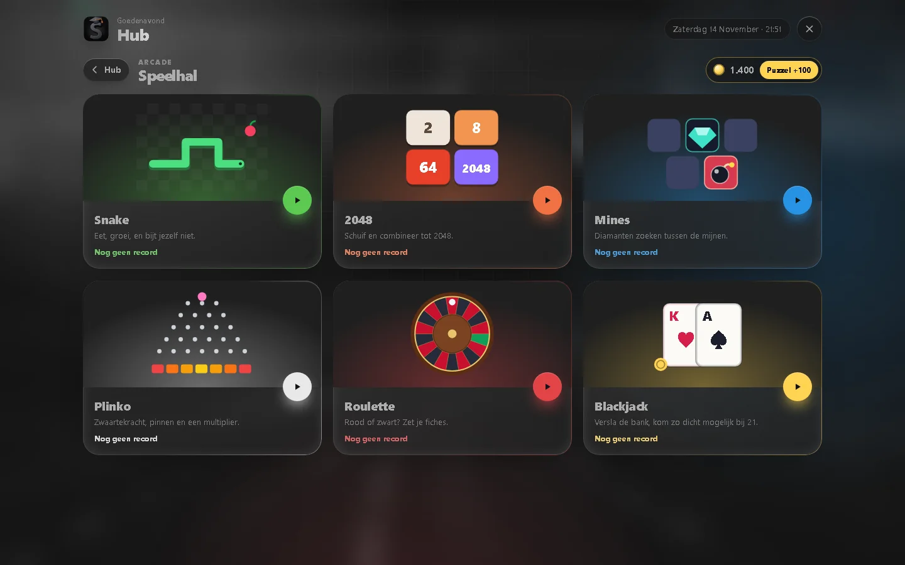
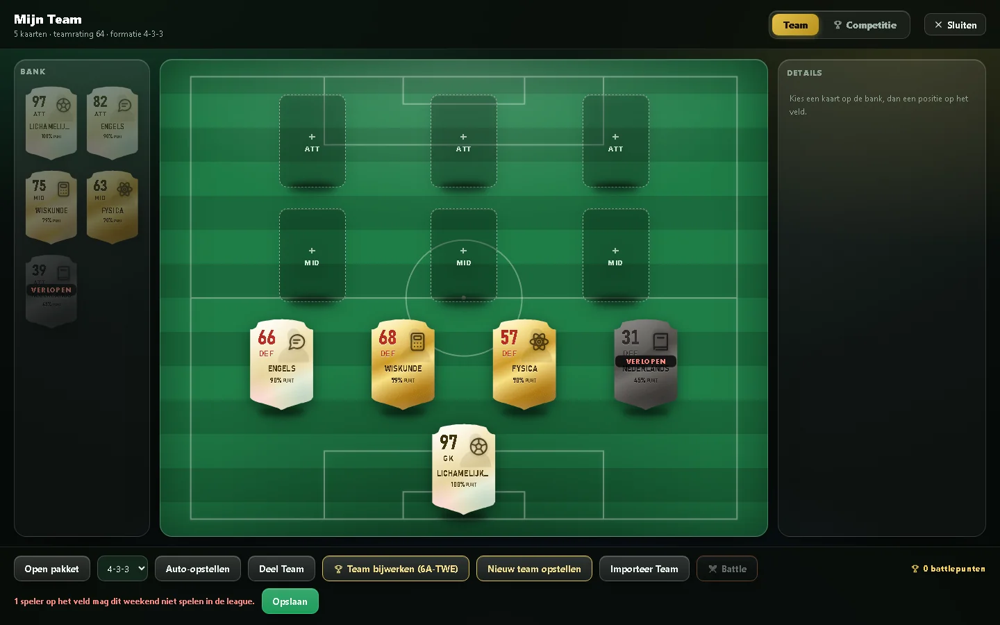
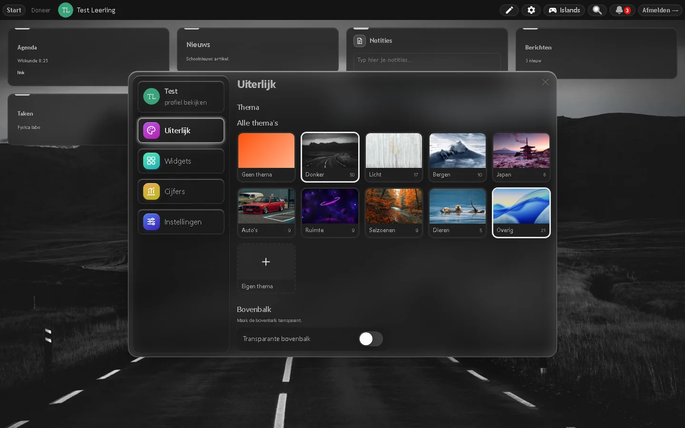
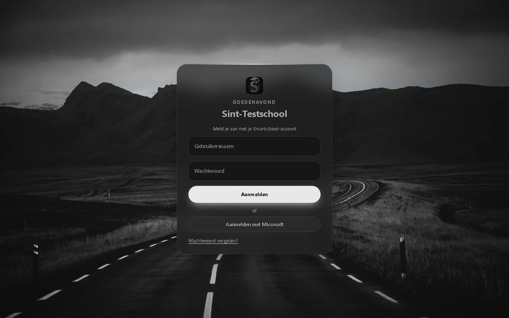

  

<h1 align="center">Smartschool Combined</h1>

  Smartschool, maar dan beter: thema's, een hub met games, Ultimate Team-kaarten van je cijfers, een klascompetitie, schaken en meer. 
  <b>Gratis voor Microsoft Edge.</b> / Smartschool, but better: themes, a hub with games, Ultimate Team cards from your grades, a class league, chess and more.

  <a href="https://microsoftedge.microsoft.com/addons/detail/smartschool-combined/lihijfpblolldifpiokeaohbdfcnmdhe"><b>Get it on Edge Add-ons</b></a>
  &nbsp;·&nbsp; <a href="#nederlands">Nederlands</a>
  &nbsp;·&nbsp; <a href="#english">English</a>
  &nbsp;·&nbsp; <a href="CHANGELOG.md">Changelog</a>
  &nbsp;·&nbsp; <a href="https://ko-fi.com/smartschoolcombined">Support on Ko-fi</a>

  <b>Vind je het handig? Steun de ontwikkeling. / Like it? Support development.</b>  
  
  

  

---

## Nederlands

**Smartschool, maar dan beter.** Smartschool Combined is een browserextensie die Smartschool mooier maakt en er spelletjes aan toevoegt. Alles draait in je eigen browser, op de Smartschool-pagina zelf. Er is geen apart account nodig.

### 1. Pas het uiterlijk aan
- Een vernieuwde inlogpagina in glass-stijl, met de knoppen voor Microsoft en de andere aanmeldopties.
- Een transparante bovenbalk, als je dat wilt.
- Widgets en notities op de startpagina.

### 2. Kies je eigen stijl
- Thema's en live achtergronden: donker, licht, bergen, Japan, auto's, ruimte en meer.
- Of maak een eigen thema met je eigen afbeelding.

### 3. Alles op één plek: de Islands-hub
Eén scherm met zes eilanden, te openen met de knop "Islands" bovenaan. Elk eiland wordt hieronder verder uitgelegd.
- **Arcade**: speelhal met games en munten.
- **Stadion**: je Ultimate Team en de klascompetitie.
- **Boerderij**: bouw je eigen boerderij.
- **School**: snel naar je punten en evaluaties.
- **Schaken**: tegen zes bots met klok en analyse na de partij, of samen op één scherm.
- **Rekentoestel**: programma's naar je TI-84 sturen via USB (nu alleen voor de ingestelde klas).

### 4. Unbox je punten
- Elk nieuw cijfer opent als een pakje: eerst de onthulling met animatie.
- Daarna verschijnt je kaart met een walkout-animatie.
- Percentages staan naast de cijfers in het rooster.

### 5. Maak met je punten je eigen team
- Je cijfers worden spelerskaarten. Elk vak is een kaart met een rating.
- Stel je team op in een formatie en open pakketten.

### 6. Speel tegen je klas
- Speel elk weekend in de klascompetitie tegen je klasgenoten.

### 7. Speel games voor munten
- In de arcade: Snake, 2048, Mines, Plinko, Roulette en Blackjack, met munten en records.

### 8. Bouw met je munten je eigen boerderij
- Zaaien, oogsten, bakken en bestellingen leveren.

### 9. Extra munten: los puzzels op
- Draai de buizen tot er een weg loopt van pijl naar pijl. Dat levert 100 munten op.
- Soms komt er ook een logicapuzzel voorbij.

<table align="center">
  <tr>
    <td></td>
    <td></td>
  </tr>
  <tr>
    <td></td>
    <td></td>
  </tr>
  <tr>
    <td></td>
    <td></td>
  </tr>
</table>

### Installeren

**Makkelijk (aangeraden):** installeer via [Edge Add-ons](https://microsoftedge.microsoft.com/addons/detail/smartschool-combined/lihijfpblolldifpiokeaohbdfcnmdhe).

**Handmatig (voor ontwikkelaars):**
1. Download deze repository (groene knop **Code**, dan **Download ZIP**) en pak de zip uit.
2. Open `edge://extensions` in Edge (of `chrome://extensions` in Chrome).
3. Zet **Ontwikkelaarsmodus** aan.
4. Klik op **Uitgepakte extensie laden** en kies de uitgepakte map (de map met `manifest.json`).
5. Open Smartschool en vernieuw de pagina.

Let op: deze broncode bevat geen achtergrondafbeeldingen, geluiden en Firebase-sleutels. De thema's tonen dan geen foto en de competitie werkt pas met je eigen Firebase-project (zie [Zelf bouwen](#zelf-bouwen-fork)). De versie in Edge Add-ons heeft alles.

### Privacy

- Je cijfers en instellingen blijven in je browser (`chrome.storage`).
- Alleen de klascompetitie en de gedeelde rekentoestel-programma's gebruiken een server (Firebase Realtime Database, anoniem aangemeld).
- Als je je inschrijft voor de competitie, komen je naam, je team en je kaarten op die server. Een kaart toont een vak en een rating die uit je cijfer komt, en je klasgenoten in de competitie kunnen die zien. Schrijf je niet in als je dat niet wilt.
- Geen tracking, geen advertenties.

---

## English

**Smartschool, but better.** Smartschool Combined is a browser extension that makes Smartschool look better and adds games on top. Everything runs in your own browser, on the Smartschool page itself. No extra account is needed.

### 1. Customise the look
- A redesigned glass-style login page, keeping the Microsoft button and the other sign-in options.
- An optional transparent top bar.
- Widgets and notes on the start page.

### 2. Pick your own style
- Themes and live wallpapers: dark, light, mountains, Japan, cars, space and more.
- Or make a custom theme with your own image.

### 3. Everything in one place: the Islands hub
One screen with six islands, opened from the "Islands" button in the top bar. Each island is explained further below.
- **Arcade**: a game hall with coins.
- **Stadium**: your Ultimate Team and the class league.
- **Farm**: build your own farm.
- **School**: a shortcut to your grades and evaluations.
- **Chess**: play six bots with a clock and post-game analysis, or two players on one screen.
- **Calculator**: send programs to your TI-84 over USB (currently limited to one configured class).

### 4. Unbox your points
- Every new grade opens like a pack: first the reveal animation.
- Then your card appears with a walkout animation.
- Percentages sit next to the grades in the grid.

### 5. Build your own team with your points
- Your grades become player cards: every subject is a card with a rating.
- Pick a formation and open packs.

### 6. Play against your class
- Play your classmates every weekend in the class league.

### 7. Play games for coins
- In the arcade: Snake, 2048, Mines, Plinko, Roulette and Blackjack, with coins and high scores.

### 8. Build your own farm with your coins
- Plant, harvest, bake and deliver orders.

### 9. Extra coins: solve puzzles
- Turn the pipes until one track runs from arrow to arrow. That gives 100 coins.
- Now and then a logic puzzle shows up too.

<table align="center">
  <tr>
    <td></td>
    <td></td>
  </tr>
  <tr>
    <td></td>
    <td></td>
  </tr>
  <tr>
    <td></td>
    <td></td>
  </tr>
</table>

### Install

**Easy (recommended):** install from [Edge Add-ons](https://microsoftedge.microsoft.com/addons/detail/smartschool-combined/lihijfpblolldifpiokeaohbdfcnmdhe).

**Manual (for developers):**
1. Download this repository (green **Code** button, then **Download ZIP**) and unzip it.
2. Open `edge://extensions` in Edge (or `chrome://extensions` in Chrome).
3. Turn on **Developer mode**.
4. Click **Load unpacked** and pick the unzipped folder (the one with `manifest.json`).
5. Open Smartschool and reload the page.

Note: this source does not include the wallpaper images, the sound effects or any Firebase keys. Themes show no photo, and the league only works with your own Firebase project (see below). The Edge Add-ons version has everything.

### Privacy

- Your grades and settings stay in your browser (`chrome.storage`).
- Only the class league and the shared calculator programs use a server (Firebase Realtime Database, anonymous sign-in).
- If you join the league, your name, team and cards are stored there. A card shows a subject and a rating based on your grade, and classmates in the league can see it. Do not join if you do not want that.
- No tracking, no ads.

---

## Zelf bouwen (fork)

Plain JavaScript, Manifest V3, no build step and no external libraries. The UI lives in a shadow DOM so Smartschool's own CSS cannot break it.

To run the league on your own backend:
1. Create a Firebase project with a **Realtime Database** and turn on **Anonymous** sign-in.
2. Copy `firebase-config.example.js` to `firebase-config.js` and fill in your values. `firebase-config.js` is git-ignored, never commit it.
3. Put your `databaseURL` in `host_permissions` in `manifest.json`.
4. Deploy `database.rules.json` and replace `YOUR_SMARTSCHOOL_USER_ID` with the Smartschool user id that may manage calculator programs.

Without `firebase-config.js` the extension falls back to the example file: everything works except the online parts.

Tests: `node tests/chess-perft.js` and `node tests/chess-bot.js`.

## Credits

- [Smartschool++](https://github.com/sprksoft/smpp) by sprksoft: the settings window, top-bar icons and theme approach are based on it.
- [CijferReveal](https://github.com/js664/CijferReveal) by js664: the card tilt, glare and flip effects of the grade reveal. Licensed under PolyForm Noncommercial 1.0.0.
- Design inspiration (no code copied): [Apple Human Interface Guidelines](https://developer.apple.com/design/human-interface-guidelines/), [apple-ui-design](https://github.com/Tamoza4/apple-ui-design), [liquid-glass-component-kit](https://github.com/h0rhay/liquid-glass-component-kit), [glass-aurora-ui](https://github.com/IntMainJhy/glass-aurora-ui), [WindElements](https://github.com/muhammad-fiaz/WindElements), [typeui](https://github.com/bergside/typeui) and [SmarterSmartchool](https://github.com/EbbDrop/SmarterSmartchool).
- 3D island art: models from [Poly Pizza](https://poly.pizza) under CC BY 3.0, see [assets/islands/CREDITS.md](assets/islands/CREDITS.md).
- Farm art: [Kenney](https://kenney.nl) (CC0), see [farm/CREDITS.txt](farm/CREDITS.txt).

Smartschool is a trademark of its owner. This project is not affiliated with or endorsed by Smartschool.

## Steun / Support

Smartschool Combined is en blijft gratis, zonder betaalmuur. Wil je de ontwikkeling steunen? Trakteer op een koffie via [Ko-fi](https://ko-fi.com/smartschoolcombined) of [PayPal](https://paypal.me/smartschoolcombined).
The extension is and stays free. If you want to support development, you can buy me a coffee on [Ko-fi](https://ko-fi.com/smartschoolcombined) or via [PayPal](https://paypal.me/smartschoolcombined).

## License

The original code is MIT licensed, see [LICENSE](LICENSE). Parts based on other projects keep their own terms, see [NOTICE.md](NOTICE.md). Because of the CijferReveal parts, this project as a whole may **not** be used commercially.
